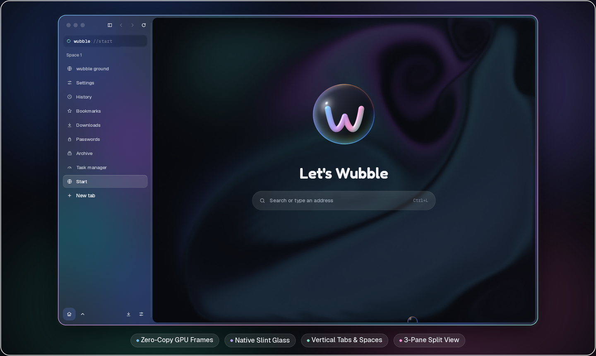

<div align="center">

<picture>
  <source media="(prefers-color-scheme: dark)" srcset="docs/readme/logo-dark.svg"/>
  
</picture>

**A Chromium-based browser where the whole window is one scene**

<a href="https://github.com/xuckless/wubble/actions/workflows/ci.yml"></a> <a href="#license"></a>

[wubble.cc](https://wubble.cc) · [Install](#install) · [Features](#features) · [How it works](#how-it-works) · [Build](#build) · [Roadmap](TODO.md)

<br/>



</div>

wubble is an open-source web browser for Linux and macOS. It runs on Chromium, so sites work as they do in Chrome, and its whole window, pages included, is drawn as one piece of glass on the GPU.

> **Preview.** Usable day to day on Linux, but young: keep another browser around.

## Install

```sh
curl -fsSL https://raw.githubusercontent.com/xuckless/wubble/main/scripts/release/install.sh | sh
```

No root needed, on Linux (x86_64) and macOS (Apple silicon); on a Mac there is also a `.dmg` on the [Releases](https://github.com/xuckless/wubble/releases) page. To remove wubble, add `-s -- --uninstall`; your profile is kept. The script checks the archive's sha256, and the signatures of the archive and the release manifest too when [`minisign`](https://jedisct1.github.io/minisign/) is installed (without it, it says so; add `-s -- --require-signature` to refuse instead).

wubble updates itself: it checks GitHub when it opens and installs a new version on the next start, signature-checked. That check is the only request wubble makes by itself, and Settings → Updates turns it off.

Tested on Fedora (GNOME, Wayland). Ubuntu 23.10 and later restrict the sandbox Chromium needs, so wubble may not start there yet.

## Features


**Tabs and Spaces**
- Vertical tabs in a sidebar that collapses to a rail or hides and peeks from the edge
- Spaces, each with its own name, icon, colour and cookies
- Pinned tabs, folders, and an archive for tabs you stopped visiting
- Tabs you are not looking at go to sleep and wake when selected

**Browsing**
- Split view: up to three pages side by side
- A command bar that finds tabs, history and actions
- Peek at a link without leaving the page (<kbd>Shift</kbd>+click)
- Reader, find in page, zoom, PDF, print, screenshots, link hints, picture-in-picture
- Video controls over any video: speed, loop, frame step, save
- H.264 and AAC playback (protected, DRM video does not play)

**Privacy**
- A content blocker built on Brave's [adblock-rust](https://github.com/brave/adblock-rust), with cookie-banner and tracking-parameter lists
- An encrypted password manager with autofill
- Nothing phones home: wubble makes no request of its own unless you turn it on (the update check is the one default)

**For AI agents**
- A built-in [MCP](https://modelcontextprotocol.io) server lets an agent on your computer (Claude Code, Codex, Gemini CLI, Cursor and others) browse in wubble
- Off by default; every session needs your approval, runs in its own Space, and is limited to the sites you allow
- Local only: a private socket, never a network port

**And**
- Native menus, dialogs, downloads and settings, with search and a shortcut editor
- History, bookmarks, downloads, a task manager and DevTools
- Import Spaces, tabs, bookmarks and history from Zen, Firefox and Arc
- Signed automatic updates

<kbd>Ctrl</kbd>+<kbd>T</kbd> new tab · <kbd>Ctrl</kbd>+<kbd>L</kbd> address · <kbd>Ctrl</kbd>+<kbd>W</kbd> close · <kbd>Ctrl</kbd>+<kbd>F</kbd> find · <kbd>Ctrl</kbd>+<kbd>\\</kbd> split · <kbd>Ctrl</kbd>+<kbd>Alt</kbd>+<kbd>Z</kbd> sidebar

Coming: extensions. The order is in [TODO.md](TODO.md).

### The sidebar

Extended, a narrow rail, or hidden. When hidden, the window's edge brings it back over the page.



### Split view



### Tabs that sleep


## How it works

Chromium renders each page off-screen. The shell, written in [Slint](https://slint.dev), draws those pages as GPU textures beside its own glass, so the sidebar, the page and every animation land in the same frame. Page frames never pass through the CPU.




wubble is written in Rust on [CEF](https://bitbucket.org/chromiumembedded/cef), [Slint](https://slint.dev) and [wgpu](https://wgpu.rs).

## Build

```sh
cargo build --workspace     # the first build downloads prebuilt CEF (about 1 GB)
cargo run -p wubble -- example.com
cargo test --workspace
```

Needs stable Rust, CMake and Ninja. A source build has no H.264 or AAC; the releases use our own CEF build ([how](docs/research/cef-codec-build.md)). Working rules are in [AGENTS.md](AGENTS.md), decisions in [docs/decisions.md](docs/decisions.md), every test command in [docs/smokes.md](docs/smokes.md).

## License

[GPL-3.0-only](LICENSE). Code adapted from other projects is listed in [THIRD_PARTY_NOTICES.md](THIRD_PARTY_NOTICES.md).
