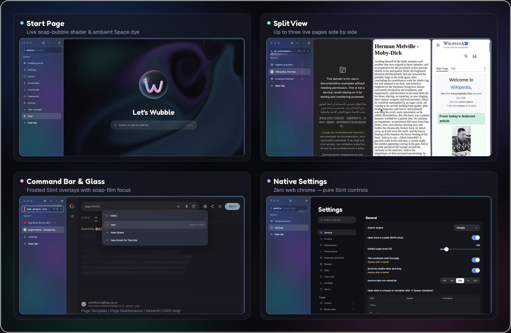

<div align="center">

<picture>
  <source media="(prefers-color-scheme: dark)" srcset="docs/readme/logo-dark.svg"/>
  
</picture>

**A Chromium-based browser where the whole window is one scene**

<a href="https://github.com/xuckless/wubble/actions/workflows/ci.yml"></a> <a href="#license"></a>

[Install](#install) · [Build](#build) · [What works](#what-works-today) · [How it works](#how-it-works) · [Roadmap](TODO.md)

<br/>


</div>

wubble is an open-source web browser for Linux and macOS, written in Rust. It has vertical tabs, Spaces, split view, a built-in content blocker and password manager, and it is built on Chromium (CEF) with a [Slint](https://slint.dev) shell drawn on the GPU with [wgpu](https://wgpu.rs).

> **Preview.** wubble is usable day to day on Linux, but it is young: expect rough edges, and keep another browser around. There are no extensions or sync yet.

## Install

Linux (x86_64), no root needed:

```sh
curl -fsSL https://raw.githubusercontent.com/xuckless/wubble/main/scripts/release/install.sh | sh
```

This downloads the newest preview from [Releases](https://github.com/xuckless/wubble/releases), checks it, and installs it under `~/.local/share/wubble` with a launcher in `~/.local/bin` and an entry in your apps. Run it again to update by hand, or with `| sh -s -- --uninstall` to remove wubble (your profile is kept).

- **Updates.** wubble checks GitHub for a new version when it opens and installs it on the next start. Every update is signature-checked. This is the one request wubble makes by itself; turn it off in Settings → Updates.
- **Checking the download.** The script always checks the SHA-256. With [`minisign`](https://jedisct1.github.io/minisign/) installed it also checks the signature.
- **Video.** The builds play H.264 and AAC. Protected (DRM) video does not play.
- **Tested on Fedora** (GNOME, Wayland). Ubuntu 23.10 and later limit the sandbox Chromium uses without root, so wubble may not start there yet; other distributions are untested.
- **macOS** builds are on the way; until then, build from source.

## Build

```sh
cargo build --workspace     # first build downloads prebuilt CEF (about 1 GB)
cargo run -p wubble -- example.com
```

Needs stable Rust, CMake and Ninja. Developed on Linux (Wayland, Vulkan). macOS is being brought up; Windows is built in CI only. A source build uses the prebuilt CEF, which has no H.264 or AAC; the release builds use our own CEF build ([how](docs/research/cef-codec-build.md)). Releases are made with [docs/release.md](docs/release.md).

## One scene, no seams

Chromium renders each page off-screen. The shell, written in [Slint](https://slint.dev), composites those pages as GPU textures next to its own glass, so the sidebar, the page and every animation are drawn in the same frame.


- **Zero copy.** Page frames travel from Chromium to the screen as GPU textures. Nothing is read back to the CPU on the frame path.
- **Native chrome.** Menus, dialogs, downloads, permissions and settings are Slint, not web pages. DevTools and Chromium's own diagnostic pages are the exceptions.
- **A sidebar, not a toolbar.** Vertical tabs, Spaces, a command bar on <kbd>Ctrl</kbd>+<kbd>L</kbd>, a start page on <kbd>Ctrl</kbd>+<kbd>T</kbd> and a sidebar that collapses to a rail or hides and peeks from the edge.

### The sidebar

It has three modes: extended, a narrow rail, and hidden. When hidden, moving to the edge of the window peeks it back over the page.


## What works today



On Linux, checked by the smoke runs in [docs/smokes.md](docs/smokes.md):

- Pages render through the zero-copy path, with colours checked against known swatches.
- Tabs that sleep when hidden and restore when opened; pinned tabs, folders, an archive for tabs left unvisited; sessions, history and bookmarks saved per profile.
- Spaces, each with its own name, icon, colour and cookie container, switched from one popup in the sidebar.
- Split view with up to three pages side by side; a peek for links (<kbd>Shift</kbd>+click); picture-in-picture.
- A start page, a command bar that finds tabs, history and actions, find in page, zoom, a reader, PDF, print, screenshots and link hints.
- A content blocker built on Brave's [adblock-rust](https://github.com/brave/adblock-rust), with cookie-banner and tracking-parameter lists. It downloads no lists unless you turn that on.
- An encrypted password store keyed from the OS keyring, with autofill and a save prompt.
- A strip of video controls over any video (speed, loop, frame step, save), and a media downloader that never touches protected streams.
- DevTools, a task manager, and pages for history, bookmarks, downloads, passwords and the archive, all linked from Settings.
- A settings page (<kbd>Ctrl</kbd>+<kbd>,</kbd>) built from one table of settings, with search and a shortcut editor.
- Signed automatic updates.

Not there yet: extensions, sync, HDR output, a macOS release, Windows. The order is in [TODO.md](TODO.md).

<kbd>Ctrl</kbd>+<kbd>T</kbd> new tab · <kbd>Ctrl</kbd>+<kbd>L</kbd> address · <kbd>Ctrl</kbd>+<kbd>W</kbd> close · <kbd>Ctrl</kbd>+<kbd>F</kbd> find · <kbd>Ctrl</kbd>+<kbd>\\</kbd> split · <kbd>Ctrl</kbd>+<kbd>Alt</kbd>+<kbd>Z</kbd> sidebar

### Split view

Up to three pages side by side.


### Tabs that sleep

Tabs you are not looking at go to sleep, and selecting one restores it.



## How it works



```
Chromium (CEF, windowless) -> shared GPU texture -> wgpu import -> Slint image
        model (tabs, Spaces, sleep) -> effects -> engine and gfx carry them out
```

| Crate | Role |
|---|---|
| `wubble-core` | Tabs, Spaces, sleep policy, command bar ranking, motion. Pure logic, no CEF, wgpu or Slint |
| `wubble-engine` | The only crate that names CEF types |
| `wubble-gfx` | Page frames to `wgpu` textures; the backdrop and glass renderer |
| `wubble-ui` | The Slint shell |
| `wubble-store` | Sessions, history, bookmarks and settings in one database |
| `wubble-blocker`, `wubble-vault`, `wubble-import` | Content blocking, passwords, import from other browsers |
| `wubble-ax`, `wubble-sysmem` | A page's accessibility tree; memory and CPU readers |
| `wubble-release` | Signs releases and writes the update manifest |
| `wubble` | The binary that wires them together |

Anything with a lifecycle is one `enum` and one pure `transition(state, event) -> (state, effects)`; only the engine and gfx crates carry effects out.

## Develop

```sh
cargo test --workspace
cargo clippy --workspace --all-targets -- -D warnings
scripts/headless.sh cargo run -p wubble -- --smoke frames=120    # checks the pixels on an invisible display, exits
```

Working rules are in [AGENTS.md](AGENTS.md), decisions in [docs/decisions.md](docs/decisions.md), the full command list in [docs/smokes.md](docs/smokes.md). Nothing in the tests depends on how fast the machine is.

Code adapted from other projects says so in its header; the full list is in [THIRD_PARTY_NOTICES.md](THIRD_PARTY_NOTICES.md). Built on [CEF](https://bitbucket.org/chromiumembedded/cef) through [cef-rs](https://github.com/tauri-apps/cef-rs), [Slint](https://slint.dev), [wgpu](https://wgpu.rs), a fork of [welding](https://crates.io/crates/welding) in `vendor/welding`, [adblock-rust](https://github.com/brave/adblock-rust) and [Turso](https://github.com/tursodatabase/turso).

## License

[GPL-3.0-only](LICENSE).
